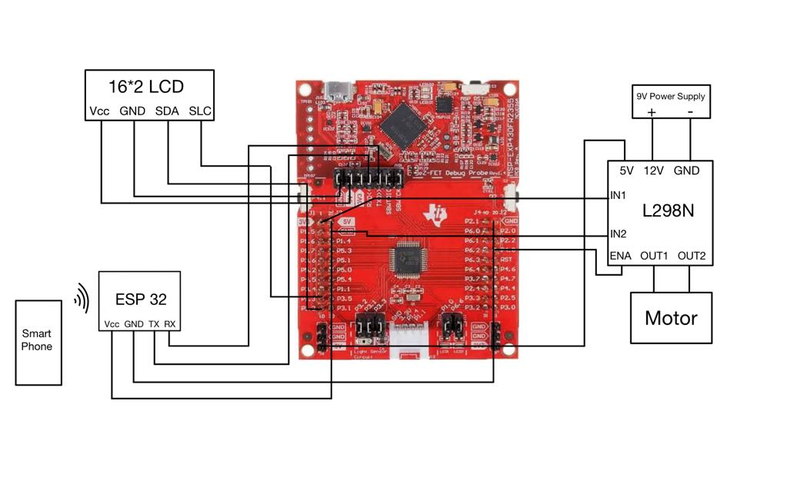

# Wi-Fi Motor Speed Controller

Control a DC motor from a phone browser using an ESP32 and an MSP430. The ESP32 hosts a Wi-Fi control page, sends the requested speed over UART, and the MSP430 updates the motor PWM and LCD readout.

[](https://www.youtube.com/watch?v=AnwuKmIC5tc)

[Watch the hardware demo](https://www.youtube.com/watch?v=AnwuKmIC5tc)

## Circuit



The ESP32 connects to the MSP430 over UART (GPIO 17 TX to the MSP430 RX, common ground). The MSP430 drives the L298N motor controller and the 16x2 I2C LCD. The motor uses a separate supply as shown in the original diagram.

## How it works

1. Connect a phone to the ESP32 access point and open **http://192.168.4.1/**.
2. Move the speed slider between 0 and 100%.
3. The ESP32 sends the value over UART at 115200 baud.
4. The MSP430 validates the value, updates Timer B PWM, and shows it on the LCD.

## Source

- `esp32/motor_control.ino` - ESP32 access point, web control page and UART sender.
- `msp430/main.c` - UART receiver, Timer B PWM and LCD display.
- `msp430/speed_protocol.h` - input validation shared with a small host-side test.
- `original/` - program listings recovered from the original project report.

## Run

1. Open `esp32/motor_control.ino` in Arduino IDE with ESP32 board support and upload it to the ESP32.
2. Add the original `LiquidCrystal_I2C` implementation to a Code Composer Studio MSP430 project with `msp430/main.c` and `msp430/speed_protocol.h`.
3. Wire the ESP32 UART, MSP430, LCD and motor driver as in the circuit diagram, then program the MSP430.
4. Connect to **ESP32-Network** (password: `Esp32-Password`) and visit **http://192.168.4.1/**.

To test the command parser with a desktop C compiler:

```sh
cc -std=c99 -Wall -Wextra -Werror tests/test_speed_protocol.c -o test_speed
./test_speed
```

## Background

Originally developed by Abdul Nafeh for an embedded systems final project at the University of South Florida. The original source is preserved alongside a cleaned, updated version.